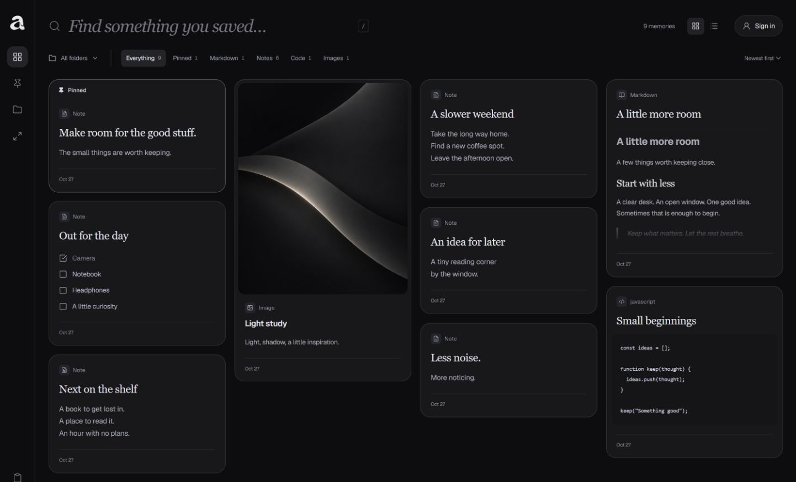
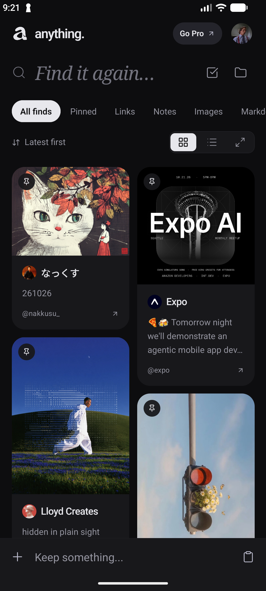
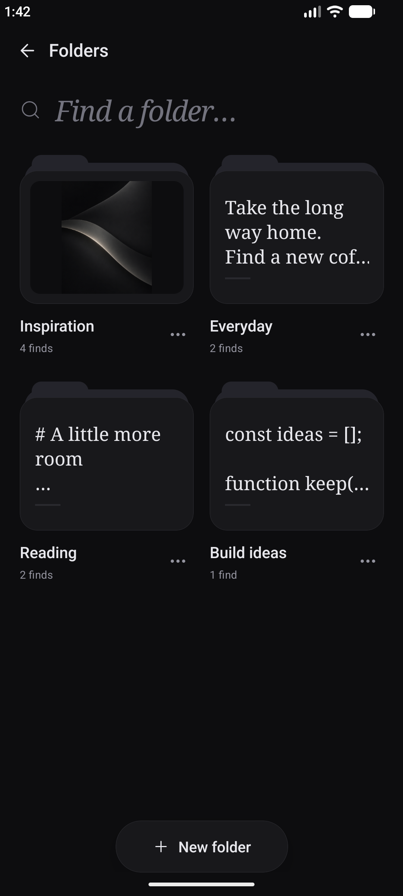

<p align="center">
  
</p>

<h1 align="center">Anything.</h1>
<p align="center"><strong>Good finds. Yours to keep.</strong></p>

<p align="center">
  A calm place for the things you want to keep.<br />
  Links, notes, images, code, and ideas — in one personal collection.
</p>

<p align="center">
  <a href="https://shobhitshah1.github.io/anything/about/">Promotional website</a> ·
  <a href="https://shobhitshah1.github.io/anything/">Open web app</a> ·
  <a href="#a-look-inside">Take a look</a> ·
  <a href="#run-it-locally">Get started</a> ·
  <a href="#save-from-your-browser">Browser extension</a> ·
  <a href="https://github.com/ShobhitShah1/anything/issues">Share an idea</a>
</p>

## Website links

- **Promotional website:** [shobhitshah1.github.io/anything/about/](https://shobhitshah1.github.io/anything/about/) ? the app introduction, web preview, mobile gallery, and policy links.
- **Web app:** [shobhitshah1.github.io/anything/](https://shobhitshah1.github.io/anything/) ? open your collection and sign in.
- **Local promotional preview:** [127.0.0.1:5501/website/public/index.html](http://127.0.0.1:5501/website/public/index.html) when Live Server is running on port 5501. This address works only on your computer.

The public hostname is `shobhitshah1.github.io`; `/anything/about/` is the promotional site's path. Edit its files in [`website/public/`](website/public/) and its links/support details in [`site-config.json`](website/public/site-config.json). See the [website guide](website/README.md) for the standalone preview command. Push to `main` to deploy both sites through [GitHub Actions](https://github.com/ShobhitShah1/anything/actions/workflows/deploy.yml).

## Less scattered. More saved.

That useful link. The half-formed idea. The snippet you keep searching for.
Anything gives them a home, so you can get back to what you were doing.

- **Keep different things together.** Bookmarks, social links, notes, checklists, Markdown, images, and code snippets.
- **Capture without the detour.** Paste a link or write a thought. The editor detects the content type, and link details load in the background.
- **Make a little order.** Use folders and tags, pin your favorites, and search your collection.
- **Find your view.** Browse a full-width masonry grid, switch to a list, or focus on one item at a time.
- **Set the mood.** Switch between porcelain light and matte black. Your theme choice stays with you.
- **Take it with you.** Export a JSON backup and import it when you need it.

Start without an account, or continue with Google and choose whether to sync your collection. Signing in alone does not upload your saves.

## A look inside

**On the web.**



**On mobile.**

<p align="center">
  
  &nbsp;
  
</p>

<sub>Unaltered captures of the running web and Android apps using fictional sample content. No personal account or private saves are shown.</sub>

## Mobile and the showcase

The Android app lives in [`mobile/`](mobile/README.md). See its setup guide for development builds and [purchase setup](mobile/PURCHASES.md) before configuring subscriptions. A public store download is not linked until the release is available.

The [product website](https://shobhitshah1.github.io/anything/about/) introduces mobile and web together. Its [source and editing guide](website/README.md) cover the static pages, product images and the single [configuration file](website/public/site-config.json) for support details, store links and policy text. Privacy, permissions, terms and data-deletion pages remain explicitly marked as drafts until the operator completes the release details.

Project folders: `src/` and `public/` contain the collection web app, `mobile/` contains Android/iOS app code, and `website/public/` contains the product website. Push changes to `main` to publish through the existing GitHub Pages workflow. The local `store-listing/` screenshot studio is ignored and is not deployed.

## A few keys worth knowing

- <kbd>Ctrl</kbd> / <kbd>⌘</kbd> + <kbd>K</kbd> — capture something.
- <kbd>Ctrl</kbd> / <kbd>⌘</kbd> + <kbd>V</kbd> — paste into a new capture when you're outside an input.
- <kbd>Ctrl</kbd> / <kbd>⌘</kbd> + <kbd>Enter</kbd> — save your item.
- <kbd>/</kbd> — search your collection.
- <kbd>Esc</kbd> — return from the editor or close a viewer.

## Run it locally

You'll need **Node.js 24+**.

```bash
git clone https://github.com/ShobhitShah1/anything.git
cd anything
npm ci
npm run dev
```

Open the local address printed in your terminal.

Built with React, TypeScript, Vite, Tailwind CSS, and Motion.
See the [setup guide](docs/SETUP.md) for production builds, GitHub Pages, and preview checks.

## Save from your browser

The **Save to Anything** extension adds right-click saving to Chrome and Edge. It connects to your existing Anything collection; no account is required.

### Install and connect

1. In Anything, open **Settings → Capture → Browser extension → Download browser extension**.
2. Extract the ZIP into a folder you can keep. If you cloned this repository, you can use the `extension/` folder directly.
3. Open `chrome://extensions` in Chrome or `edge://extensions` in Edge. Enable **Developer mode**, choose **Load unpacked**, and select the folder containing `manifest.json`.
4. Open **Save to Anything** from your browser’s Extensions menu. You can pin it to the toolbar for easy access.
5. Set **Your Anything address** to the full address of your collection, including its path. For example, `http://localhost:5173/` for local development, or `https://your-name.github.io/anything/` for a deployed copy. Anything’s extension setup panel shows your current address.
6. Click **Connect collection** and allow access to that address when prompted. Keep the local development server running if you use a localhost address.

### Save what you find

- **Right-click** a page, link, image, or selected text and choose **Save to Anything**.
- **Click the toolbar extension** and choose **Save this page** to keep the current page.
- **Automatically save copied text:** enable **Auto-save text I copy** in the extension popup and grant the requested permissions. It captures text and links you copy on websites; password fields are excluded. This option is off by default.

Anything opens in a background tab when needed. Saves wait in the extension until the app confirms they were stored. Repeated content is skipped, and link details load in the background.

Inside Anything, the compact bottom bar also accepts one or several links. Paste them and press **Enter** or the arrow; when the field is empty, its clipboard button saves copied links directly. For clipboard capture while using the app, open **Settings → Capture → Auto-save clipboard**. This separate setting checks new clipboard text only while Anything is visible and focused, with browser permission.

### Updates and troubleshooting

- **Saves are waiting or the badge shows a count:** check your Anything address and open the collection. If it is hosted locally, start its development server. Connect the extension again if the address changed.
- **Nothing happens when copying:** enable the extension’s copy option, allow its requested permissions, and reload website tabs that were already open. Browser internal pages restrict extensions; use an ordinary website to check it.
- **Updating an unpacked extension:** replace its files with the latest version, then click **Reload** on the browser’s Extensions page. Keep the extracted folder in place.

Copy capture works with website text while the browser is running. It does not monitor other desktop apps or provide cloud sync. Use the same browser profile and Anything address as your collection; a different origin or profile has separate storage.

## Storage and optional sync

Anything saves items in your browser. Export a backup before clearing browser data or moving to a different browser or device. Optional Google sign-in and Firebase cloud sync can be configured with the [Firebase setup guide](docs/FIREBASE.md). Enable **Cloud sync** from your profile/settings to merge saves and folders across devices.

Link previews may contact the linked site and external metadata or image services. Microlink provides general metadata, FxTwitter handles X posts, and Noembed handles supported video links. Preview requests have a five-second deadline; you can save immediately and use Refresh preview in the item details to try again. Some sites do not provide a usable cover image. Secret fields are included when you enable collection sync; masking is **not encryption**, and cloud secrets are not end-to-end encrypted. Uploaded images over the app’s Firestore record limit remain local and report a sync error.

---

<p align="center">
  <strong>Keep what catches your eye.</strong><br />
  <sub>Found a rough edge? <a href="https://github.com/ShobhitShah1/anything/issues">Tell us about it.</a></sub>
</p>
