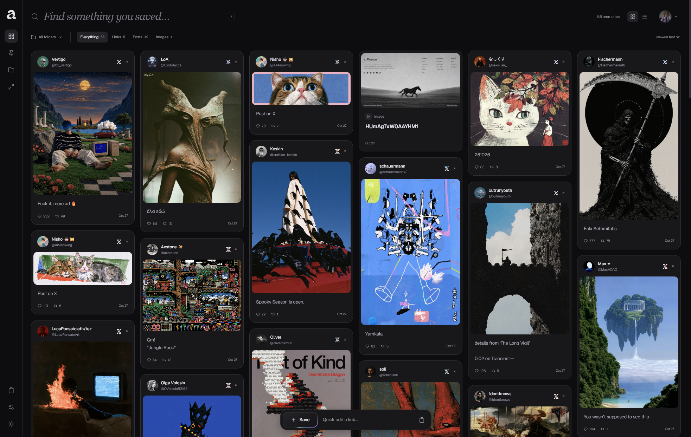
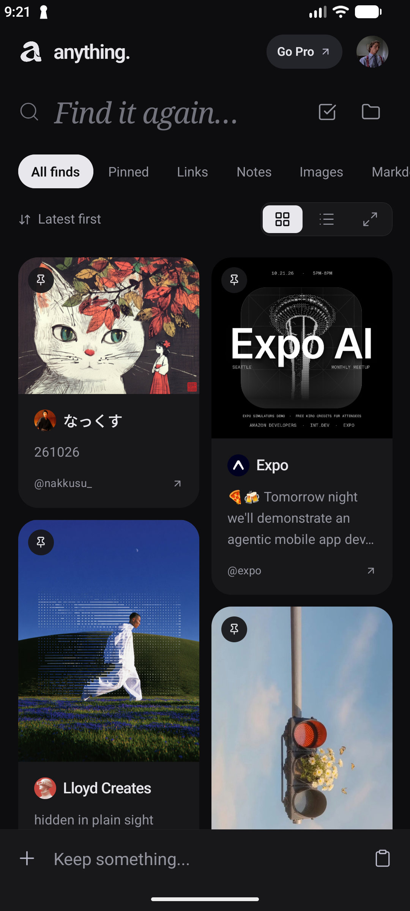

  

<h1 align="center">Anything.</h1>

<strong>Good finds. Yours to keep.</strong>

  A personal place for the links, notes, images, and ideas you want to find again.

  <a href="https://shobhitshah1.github.io/anything/">Open Anything</a>
  &nbsp; · &nbsp;
  <a href="https://shobhitshah1.github.io/anything/about/">Discover Anything</a>

## Keep the things worth keeping

Save a page you want to read later, a thought you do not want to lose, or a useful snippet you keep looking up. Anything gives them one calm, searchable home.

Save bookmarks, social posts, notes, checklists, Markdown, images, and code. Add folders and tags, pin the things you use most, and search your collection when you need it. Choose a spacious grid, a compact list, or focus on one item at a time.

## Save from your browser

The **Save to Anything** browser extension lets you save a page, link, image, or selected text from Chrome or Edge. Open **Settings → Capture → Browser extension** in Anything to download and connect it. You can also turn on clipboard capture there; it is optional and off until you enable it.

## Start on the web

1. [Open Anything](https://shobhitshah1.github.io/anything/).
2. Start saving right away, or sign in with Google.
3. To use your collection on another device, turn on **Cloud sync** in your profile or settings.

Native mobile apps are in development. Store downloads will be linked here when they are available.

## Your collection, your choice

Anything stores saves in the browser you use. Signing in does not upload them by itself; cloud sync starts only when you enable it. Export a backup before clearing browser data or moving to another browser.

If you enable sync, your saved records are stored in your Firebase project. Secret fields can be synced, but masking only hides them on screen: it is not encryption, and synced secrets are not end-to-end encrypted. Link previews may contact the linked site and preview services to retrieve titles, descriptions, and images.

Anything is designed for personal collections. Your browser profile and cloud account determine which collection you see.

<strong>Keep what catches your eye.</strong>

