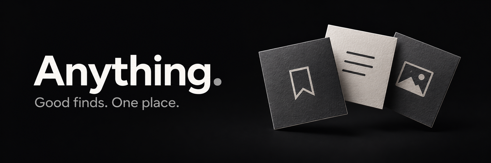
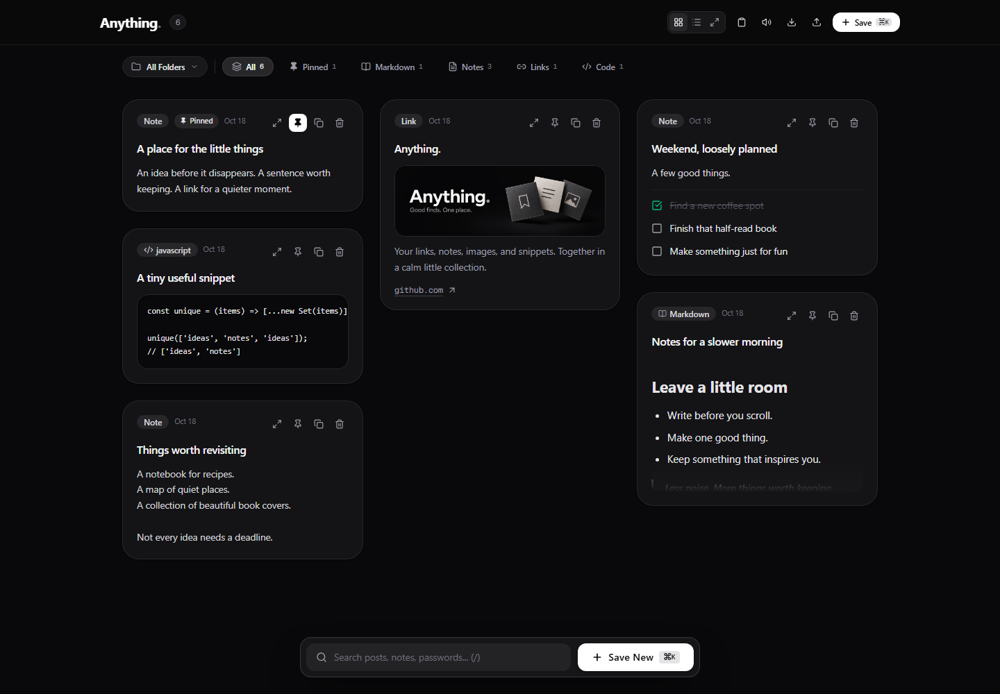
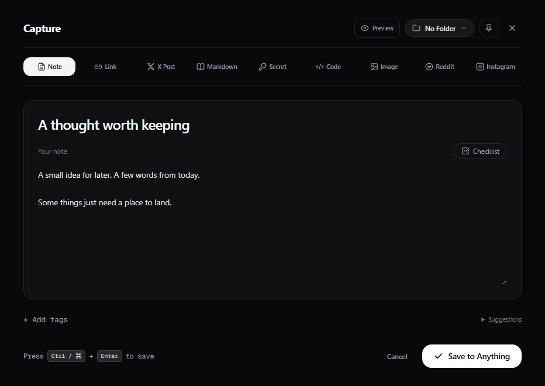

<p align="center">
  
</p>

<p align="center">
  A calm place for the things you want to keep.<br />
  Links, notes, images, code, and ideas — together in your browser.
</p>

<p align="center">
  <a href="#a-look-inside">Take a look</a> ·
  <a href="#run-it-locally">Get started</a> ·
  <a href="https://github.com/ShobhitShah1/anything/issues">Share an idea</a>
</p>

## Less scattered. More saved.

That useful link. The half-formed idea. The snippet you keep searching for.
Anything gives them a home, so you can get back to what you were doing.

- **Keep different things together.** Bookmarks, social links, notes, checklists, Markdown, images, and code snippets.
- **Capture without the detour.** Open the editor, paste or write, and save. Link details load in the background.
- **Make a little order.** Use folders and tags, pin your favorites, and search your collection.
- **Find your view.** Browse a card grid, switch to a list, or focus on one item at a time.
- **Take it with you.** Export a JSON backup and import it when you need it.

No account to create. No workspace to set up. Just open it and keep something.

## A look inside

**Your collection, at a glance.**



**A little room to think.**



<sub>Real app screenshots with fictional sample content.</sub>

## A few keys worth knowing

- <kbd>Ctrl</kbd> / <kbd>⌘</kbd> + <kbd>K</kbd> — capture something.
- <kbd>Ctrl</kbd> / <kbd>⌘</kbd> + <kbd>V</kbd> — paste into a new capture when you're outside an input.
- <kbd>Ctrl</kbd> / <kbd>⌘</kbd> + <kbd>Enter</kbd> — save your item.
- <kbd>/</kbd> — search your collection.
- <kbd>Esc</kbd> — return from the editor or close a viewer.

## Run it locally

You'll need **Node.js 24+**.

```bash
git clone https://github.com/ShobhitShah1/anything.git
cd anything
npm ci
npm run dev
```

Open the local address printed in your terminal.

Built with React, TypeScript, Vite, Tailwind CSS, and Motion.
See the [setup guide](docs/SETUP.md) for production builds, GitHub Pages, and preview checks.

## Your collection stays in this browser

Items are saved in browser storage. Export a backup before clearing browser data or moving to another device. There is no automatic sync.

Link previews may contact the linked site and external metadata or image services. Some sites do not provide a usable cover image. Masked secret fields are stored locally; masking is **not encryption**.

---

<p align="center">
  <strong>Keep what catches your eye.</strong><br />
  <sub>Found a rough edge? <a href="https://github.com/ShobhitShah1/anything/issues">Tell us about it.</a></sub>
</p>
